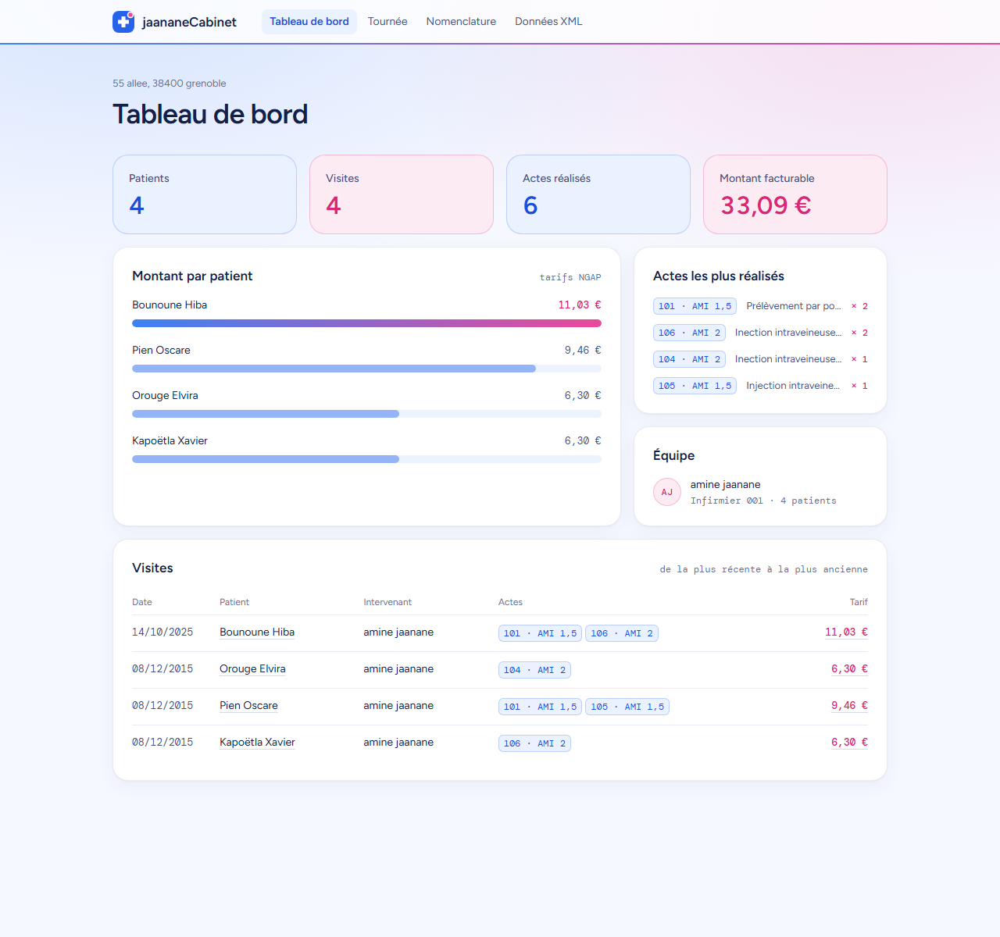
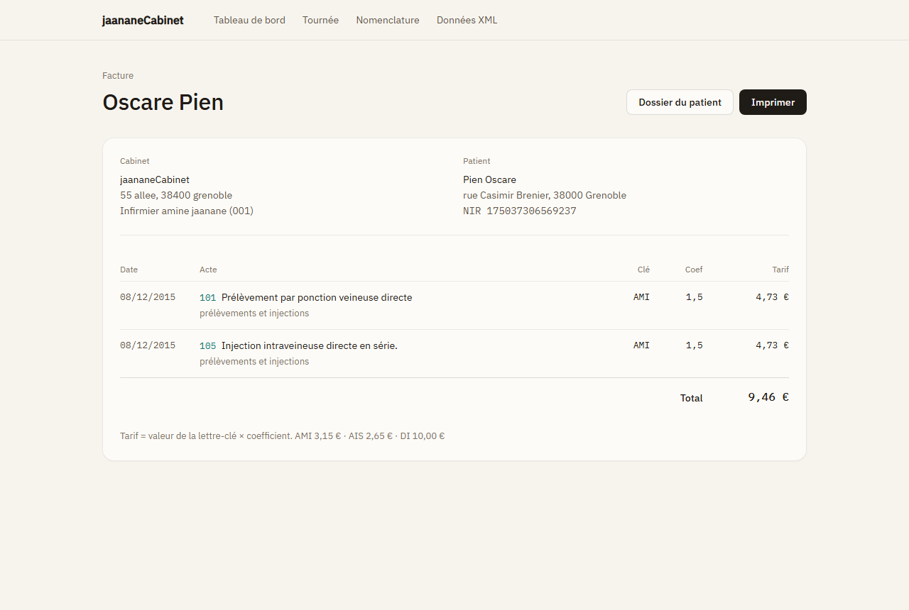
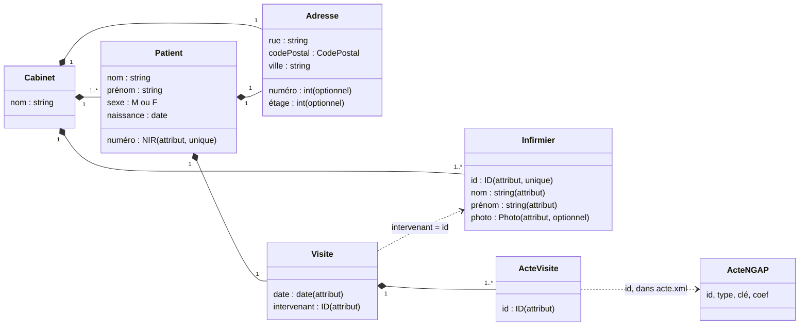
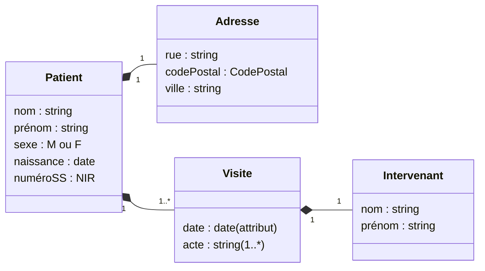
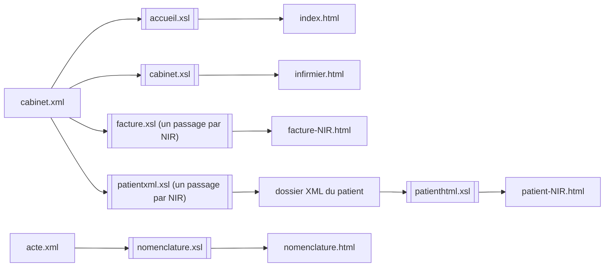

# Cabinet Infirmier

Modélisation XML d'un cabinet de soins infirmiers à domicile : les données (cabinet, infirmiers, patients, visites, nomenclature des actes) sont décrites en XML, contraintes par des schémas XSD, puis transformées en XSLT en un petit site HTML :

- le **tableau de bord** : chiffres du cabinet, montant par patient, actes les plus réalisés, liste des visites ;
- la **tournée de l'infirmier** : les patients qu'il doit voir et les soins à effectuer, avec le code NGAP et le tarif de chaque visite ;
- le **dossier de chaque patient** : ses informations et l'historique de ses visites ;
- la **facture de chaque patient** : les actes, leur cotation (lettre-clé × coefficient) et le total ;
- la **nomenclature** : les 25 actes de `acte.xml` par type, avec leur tarif et le nombre de fois où ils ont été réalisés.

Toutes les pages sont produites par XSLT 1.0 à partir de `cabinet.xml` et `acte.xml`, sans aucune donnée ajoutée.

Projet académique réalisé à partir de zéro en L3 MIAGE à l'Université Grenoble Alpes : modèle de données, schémas XSD, transformations XSLT et mise en page. Seul `data/js/facture.js` est un squelette fourni pour le TP.



---

## Sommaire

1. [Aperçu](#aperçu)
2. [Structure du dépôt](#structure-du-dépôt)
3. [Démarrage rapide](#démarrage-rapide)
4. [Modèle de données](#modèle-de-données)
5. [Schémas XSD et contraintes](#schémas-xsd-et-contraintes)
6. [Transformations XSLT](#transformations-xslt)
7. [Interface](#interface)
8. [Facturation](#facturation)
9. [Projet .NET](#projet-net)
10. [Limites connues et pistes](#limites-connues-et-pistes)
11. [Auteur](#auteur)

---

## Aperçu

| Tournée de l'infirmier | Dossier patient |
| --- | --- |
|  |  |

| Facture | Nomenclature |
| --- | --- |
|  |  |

---

## Structure du dépôt

```
CabinetInfirmier/
├── data/
│   ├── xml/
│   │   ├── cabinet.xml        Données du cabinet : infirmiers, patients, visites
│   │   ├── acte.xml           Nomenclature NGAP : types et actes avec lettre-clé et coefficient
│   │   ├── patient.xml        Exemple de dossier patient saisi à la main
│   │   └── patientxml.xml     Dossier patient généré par patientxml.xsl
│   ├── xsd/
│   │   ├── cabinet.xsd        Schéma de cabinet.xml
│   │   ├── actes.xsd          Schéma de acte.xml
│   │   └── patient.xsd        Schéma des dossiers patient
│   ├── xslt/
│   │   ├── commun.xsl         Modèles partagés : navigation, dates, tarifs (xsl:include)
│   │   ├── accueil.xsl        cabinet.xml → tableau de bord
│   │   ├── cabinet.xsl        cabinet.xml → tournée de l'infirmier
│   │   ├── facture.xsl        cabinet.xml → facture d'un patient
│   │   ├── nomenclature.xsl   acte.xml → nomenclature des actes
│   │   ├── patientxml.xsl     cabinet.xml → dossier XML d'un patient
│   │   └── patienthtml.xsl    dossier XML d'un patient → page HTML
│   ├── html/
│   │   ├── index.html           Tableau de bord, page d'accueil
│   │   ├── infirmier.html       Tournée
│   │   ├── nomenclature.html    Nomenclature des actes
│   │   ├── patient-<NIR>.html   Un dossier par patient
│   │   ├── facture-<NIR>.html   Une facture par patient
│   │   └── patienthtml.html     Dossier de référence (Hiba), résultat de patientxml.xml
│   ├── css/
│   │   ├── commun.css         Couleurs, typographie, barre de navigation, cartes, tableaux
│   │   ├── accueil.css        Tableau de bord
│   │   ├── infirmier.css      Tournée
│   │   ├── patient.css        Dossier patient
│   │   ├── facture.css        Facture
│   │   └── nomenclature.css   Nomenclature
│   ├── js/
│   │   └── facture.js         Génération d'une facture (squelette à compléter)
│   └── uml/
│       ├── cabinet.puml       Diagramme de classes du cabinet (PlantUML)
│       └── patient.puml       Diagramme de classes du dossier patient (PlantUML)
├── docker/
│   ├── generer.sh             Validation XSD et génération de toutes les pages
│   └── nginx.conf             Configuration du serveur web de l'image
├── docs/captures/             Captures d'écran utilisées dans ce README
├── Dockerfile                 Validation XSD, génération XSLT, puis service nginx
├── docker-compose.yml         Lancement en une commande, port 8085 par défaut
├── CabinetInfirmier.csproj    Projet .NET 8 (conteneur pour l'IDE)
├── CabinetInfirmier.sln
├── Program.cs
└── global.json
```

---

## Démarrage rapide

### Avec Docker

```bash
docker compose up --build
```

Puis ouvrir [http://localhost:8085](http://localhost:8085).

| Adresse | Contenu |
| --- | --- |
| `http://localhost:8085/` | Tableau de bord (redirige vers `/html/index.html`) |
| `http://localhost:8085/tournee` | Tournée de l'infirmier (redirige vers `/html/infirmier.html`) |
| `http://localhost:8085/html/nomenclature.html` | Nomenclature des actes |
| `http://localhost:8085/html/patient-<NIR>.html` | Dossier d'un patient |
| `http://localhost:8085/html/facture-<NIR>.html` | Facture d'un patient |
| `http://localhost:8085/patient` | Dossier de référence de `patientxml.xml` (redirige vers `/html/patienthtml.html`) |
| `http://localhost:8085/xml/`, `/xsd/`, `/xslt/` | Fichiers sources, consultables dans le navigateur |

Les pages sont reliées : une barre de navigation en haut (Tableau de bord, Tournée, Nomenclature, Données XML), et dans la tournée et le tableau de bord, les noms de patients et les montants mènent au dossier et à la facture. Chaque dossier a un lien vers sa facture, et chaque facture un lien vers son dossier.

À la construction, l'image lance [docker/generer.sh](docker/generer.sh) : il valide chaque fichier XML contre son schéma, génère le tableau de bord, la nomenclature et la tournée, puis un dossier et une facture par patient (chaque dossier intermédiaire est lui aussi validé contre `patient.xsd`). Si un fichier devient invalide, la construction échoue. Les pages sont ensuite servies par nginx.

Options :

```bash
# Changer le port local (8085 par défaut)
PORT=9000 docker compose up --build             # bash
$env:PORT=9000; docker compose up --build       # PowerShell

# Choisir l'infirmier de la tournée, et le patient du dossier de référence
docker compose build --build-arg INFIRMIER_ID=001 --build-arg PATIENT_PRENOM=Elvira
docker compose up

# Arrêter
docker compose down
```

Sans Compose :

```bash
docker build -t cabinet-infirmier .
docker run --rm -p 8085:80 cabinet-infirmier
```

### Voir les pages sans Docker

Les pages déjà générées s'ouvrent directement dans un navigateur :

- [data/html/index.html](data/html/index.html), le tableau de bord, d'où l'on navigue vers toutes les autres pages

Les feuilles de style sont référencées en chemin relatif (`../css/…`), il n'y a donc pas besoin de serveur. Les polices Figtree et DM Mono sont chargées depuis Google Fonts ; hors ligne, la police système prend le relais.

### Régénérer les pages sans Docker

Les commandes se lancent depuis la racine du dépôt. Les feuilles HTML chargent `acte.xml` et `cabinet.xml` depuis `commun.xsl` avec `document('../xml/…')`, chemin résolu par rapport à la feuille XSLT : il faut donc garder la structure `data/xml/` et `data/xslt/`.

**Avec le script** (Linux, macOS, WSL, avec xsltproc et xmllint installés) : il fait la validation et toutes les générations d'un coup.

```bash
sh docker/generer.sh
INFIRMIER_ID=001 PATIENT_PRENOM=Elvira sh docker/generer.sh   # avec d'autres paramètres
```

**Avec xsltproc, étape par étape** :

```bash
# Tableau de bord et nomenclature
xsltproc -o data/html/index.html        data/xslt/accueil.xsl      data/xml/cabinet.xml
xsltproc -o data/html/nomenclature.html data/xslt/nomenclature.xsl data/xml/acte.xml

# Tournée de l'infirmier 001
xsltproc --stringparam destinedId 001 \
  -o data/html/infirmier.html data/xslt/cabinet.xsl data/xml/cabinet.xml

# Facture d'un patient
xsltproc --stringparam destinedNir 175037306569237 \
  -o data/html/facture-175037306569237.html data/xslt/facture.xsl data/xml/cabinet.xml

# Dossier d'un patient choisi par son NIR : XML intermédiaire, puis page HTML
xsltproc --stringparam destinedNir 175037306569237 \
  -o /tmp/patient.xml data/xslt/patientxml.xsl data/xml/cabinet.xml
xsltproc -o data/html/patient-175037306569237.html data/xslt/patienthtml.xsl /tmp/patient.xml

# Dossier de référence, choisi par prénom
xsltproc --stringparam destinedName Hiba \
  -o data/xml/patientxml.xml data/xslt/patientxml.xsl data/xml/cabinet.xml
xsltproc -o data/html/patienthtml.html data/xslt/patienthtml.xsl data/xml/patientxml.xml
```

**Avec Saxon** (Java) :

```bash
java -jar saxon-he.jar -s:data/xml/cabinet.xml -xsl:data/xslt/cabinet.xsl \
  -o:data/html/infirmier.html destinedId=001
```

**Avec PowerShell** (moteur XSLT de .NET, rien à installer sous Windows) :

```powershell
function Invoke-Xslt($xsl, $xml, $out) {
    $t = New-Object System.Xml.Xsl.XslCompiledTransform
    $resolver = New-Object System.Xml.XmlUrlResolver
    # true = autoriser la fonction document(), nécessaire pour lire acte.xml
    $t.Load((Resolve-Path $xsl).Path, (New-Object System.Xml.Xsl.XsltSettings($true, $false)), $resolver)
    $reader = [System.Xml.XmlReader]::Create((Resolve-Path $xml).Path)
    $writer = [System.Xml.XmlWriter]::Create("$PWD\$out", $t.OutputSettings)
    $t.Transform($reader, $null, $writer, $resolver)
    $writer.Close(); $reader.Close()
}

Invoke-Xslt data\xslt\accueil.xsl      data\xml\cabinet.xml     data\html\index.html
Invoke-Xslt data\xslt\nomenclature.xsl data\xml\acte.xml        data\html\nomenclature.html
Invoke-Xslt data\xslt\cabinet.xsl      data\xml\cabinet.xml     data\html\infirmier.html
Invoke-Xslt data\xslt\patienthtml.xsl  data\xml\patientxml.xml  data\html\patienthtml.html
```

Cette fonction ne passe pas de paramètres XSLT : pour générer les dossiers `patient-<NIR>.html` et les factures `facture-<NIR>.html`, utiliser Docker ou le script.

Les IDE JetBrains (Rider, IntelliJ) et Oxygen XML permettent aussi de lancer une transformation depuis le fichier XSL.

### Valider les fichiers XML

```bash
xmllint --noout --schema data/xsd/cabinet.xsd data/xml/cabinet.xml
xmllint --noout --schema data/xsd/actes.xsd   data/xml/acte.xml
xmllint --noout --schema data/xsd/patient.xsd data/xml/patient.xml
xmllint --noout --schema data/xsd/patient.xsd data/xml/patientxml.xml
```

Les quatre fichiers sont valides par rapport à leur schéma (vérifié avec le validateur de .NET).

---

## Modèle de données

Trois espaces de noms séparent les trois vocabulaires :

| Préfixe | Espace de noms | Fichiers |
| --- | --- | --- |
| `med` | `http://www.univ-grenoble-alpes.fr/l3miage/medical` | `cabinet.xml`, `cabinet.xsd` |
| `act` | `http://www.univ-grenoble-alpes.fr/l3miage/actes` | `acte.xml`, `actes.xsd` |
| `pat` | `http://www.univ-grenoble-alpes.fr/l3miage/patient` | `patient.xml`, `patientxml.xml`, `patient.xsd` |

### Le cabinet (`cabinet.xml`)

Le cabinet a un nom, une adresse, une liste d'infirmiers et une liste de patients. Chaque patient reçoit une visite, qui référence l'infirmier intervenant par son identifiant et les actes réalisés par leur identifiant dans la nomenclature.



Extrait :

```xml
<patient numéro="206049935000375">
    <nom>Bounoune</nom>
    <prénom>Hiba</prénom>
    <sexe>F</sexe>
    <naissance>2004-04-14</naissance>
    <adresse>
        <numéro>55</numéro>
        <rue>faure</rue>
        <codePostal>38400</codePostal>
        <ville>grenoble</ville>
        <étage>4</étage>
    </adresse>
    <visite date="2025-10-14" intervenant="001">
        <acte id="101"/>
        <acte id="106"/>
    </visite>
</patient>
```

### La nomenclature des actes (`acte.xml`)

Elle reprend une partie de la NGAP (Nomenclature générale des actes professionnels). Chaque acte a un identifiant à trois chiffres, un type, une lettre-clé et un coefficient.

| Type | Libellé | Identifiants |
| --- | --- | --- |
| `pi` | Prélèvements et injections | 101 à 113 |
| `pc` | Pansements courants | 200 à 204 |
| `pl` | Pansements lourds et complexes | 300 à 303 |
| `sd` | Soins infirmiers à domicile pour un patient dépendant | 401 à 403 |

```xml
<acte id="101" type="pi" clé="AMI" coef="1.5"> Prélèvement par ponction veineuse directe </acte>
```

Le tarif d'un acte vaut **valeur de la lettre-clé × coefficient**, avec les valeurs utilisées dans `facture.js` :

| Lettre-clé | Signification | Valeur |
| --- | --- | --- |
| `AMI` | Acte médico-infirmier | 3,15 € |
| `AIS` | Acte infirmier de soins | 2,65 € |
| `DI` | Démarche de soins infirmiers | 10,00 € |

Exemple : l'acte 101 (`AMI 1,5`) vaut 1,5 × 3,15 = 4,725 €.

### Le dossier patient (`patient.xml`, `patientxml.xml`)

C'est une vue d'un seul patient, autonome : le NIR devient un élément `numéroSS`, l'intervenant est décrit par son nom et son prénom, et chaque acte par son intitulé en clair. `patient.xml` est un exemple écrit à la main ; `patientxml.xml` est produit à partir de `cabinet.xml` par `patientxml.xsl`.



Les diagrammes d'origine, au format PlantUML, sont dans [data/uml/](data/uml/). Pour les afficher, utiliser le plugin PlantUML de votre IDE ou [plantuml.com](https://www.plantuml.com/plantuml).

---

## Schémas XSD et contraintes

Tous les schémas utilisent `elementFormDefault="qualified"` : chaque élément des documents doit appartenir à l'espace de noms cible.

### Types simples

| Type | Défini dans | Contrainte | Exemple valide |
| --- | --- | --- | --- |
| `NIR` | `cabinet.xsd`, `patient.xsd` | 15 caractères, motif ci-dessous | `206049935000375` |
| `CodePostal` | `cabinet.xsd`, `patient.xsd` | `(0[1-9]\|[1-9][0-9]\|2A\|2B\|9[78])\d{3}` | `38400`, `2A004` |
| `ID` | `cabinet.xsd` | entier écrit sur 3 chiffres `[0-9]{3}` | `001`, `106` |
| `Photo` | `cabinet.xsd` | nom de fichier `.jpg`, `.jpeg` ou `.png` | `amine.png` |
| `Sexe` | `cabinet.xsd`, `patient.xsd` | énumération `M`, `F` | `F` |
| `IdAc` | `actes.xsd` | entier sur 3 chiffres | `101` |
| `IdTy` | `actes.xsd` | deux lettres minuscules `[a-z]{2}` | `pi` |

Le code postal couvre les départements 01 à 99, la Corse (`2A`, `2B`) et l'outre-mer (`97`, `98`).

### Le NIR

Le numéro de sécurité sociale est un `string` et non un `int` : 15 chiffres dépassent la capacité d'un entier 32 bits, et le zéro de tête d'un département doit être conservé.

```
[12] \d{2} (0[1-9]|1[0-2]) (0[1-9]|[1-8]\d|9[0-5]|99) \d{3} \d{3} \d{2}
 │    │     │               │                          │     │     └─ clé de contrôle
 │    │     │               │                          │     └─ rang d'inscription à l'état civil
 │    │     │               │                          └─ code Insee de la commune ou du pays
 │    │     │               └─ département de naissance (99 = né à l'étranger)
 │    │     └─ mois de naissance
 │    └─ deux derniers chiffres de l'année de naissance
 └─ sexe : 1 homme, 2 femme
```

Le motif vérifie la forme ; la clé de contrôle (97 moins le reste modulo 97 des 13 premiers chiffres) n'est pas calculée, XSD 1.0 ne permet pas ce calcul.

### Contraintes d'identité (`cabinet.xsd`)

```xml
<unique name="idInfirmier">           <!-- deux infirmiers ne partagent pas un id -->
    <selector xpath=".//med:infirmier"/>
    <field xpath="@id"/>
</unique>
<unique name="NIR">                   <!-- deux patients ne partagent pas un NIR -->
    <selector xpath=".//med:patient"/>
    <field xpath="@numéro"/>
</unique>
<keyref name="refIntervenant" refer="med:idInfirmier">
    <!-- l'intervenant d'une visite doit être un infirmier du cabinet -->
    <selector xpath=".//med:patients/med:patient/med:visite"/>
    <field xpath="@intervenant"/>
</keyref>
```

Dans `actes.xsd`, une contrainte `unique` garantit que chaque type d'acte a un `id` distinct.

---

## Transformations XSLT

Toutes les feuilles sont en XSLT 1.0, ce qui les rend utilisables avec n'importe quel processeur (navigateur, xsltproc, Saxon, .NET).



Les feuilles qui produisent du HTML incluent toutes [commun.xsl](data/xslt/commun.xsl) (`<xsl:include href="commun.xsl"/>`), qui charge `acte.xml` et `cabinet.xml` avec `document()` et fournit les modèles partagés.

### `commun.xsl` : modèles partagés

| Modèle ou variable | Rôle |
| --- | --- |
| `$actes`, `$cabinet` | `document('../xml/acte.xml')` et `document('../xml/cabinet.xml')`, disponibles dans toutes les pages |
| `$centimesAMI`, `$centimesAIS`, `$centimesDI` | valeur des lettres-clés en centimes : 315, 265, 1000 (les constantes de `facture.js`) |
| `entete-html` | `<head>` commun : titre, polices, `commun.css` et la feuille propre à la page |
| `barre` | barre de navigation, avec la page courante marquée par `aria-current="page"` |
| `date` | `AAAA-MM-JJ` vers `JJ/MM/AAAA`, dans un élément `<time datetime="…">` |
| `centimes-acte` | tarif d'un acte : `round(coef × valeur de la clé)` |
| `centimes-total` | somme récursive des tarifs d'une liste de `<acte id="…"/>` |
| `euros` | centimes vers `11,03 €` avec `format-number` et un `xsl:decimal-format` français |
| `code-acte` | étiquette du code NGAP : `101 · AMI 1,5` |

Les montants sont calculés en **centimes entiers** : additionner directement des décimaux comme 4,725 donne des erreurs d'arrondi en virgule flottante. Chaque acte est arrondi au centime, puis les tarifs sont additionnés.

Le tarif d'un acte s'écrit en une seule expression XPath, où une comparaison vaut 1 si elle est vraie et 0 sinon :

```xml
<xsl:value-of select="round($ref/@coef * (($ref/@clé = 'AMI') * $centimesAMI
                                         + ($ref/@clé = 'AIS') * $centimesAIS
                                         + ($ref/@clé = 'DI') * $centimesDI))"/>
```

XSLT 1.0 ne sait pas additionner des valeurs calculées (`sum()` ne prend que des nœuds), d'où le modèle récursif `centimes-total` : il traite le premier acte de la liste, puis se rappelle sur `$refs[position() > 1]` en transmettant le cumul.

### `accueil.xsl` : le tableau de bord

Produit `index.html` à partir de `cabinet.xml` :

- **quatre chiffres** : patients, visites, actes réalisés, montant facturable ;
- **montant par patient**, en barres classées du plus élevé au plus faible. Les montants sont d'abord calculés dans une variable, convertie avec `exsl:node-set()` pour pouvoir être triée avec `xsl:sort` ;
- **actes les plus réalisés**, regroupés par identifiant avec la méthode de Muench : `xsl:key` sur `med:visite/med:acte`, puis `generate-id() = generate-id(key('acte-par-id', @id)[1])` ;
- **équipe** : chaque infirmier et son nombre de patients ;
- **visites**, triées de la plus récente à la plus ancienne, avec liens vers le dossier et la facture.

### `cabinet.xsl` : la tournée de l'infirmier

| Paramètre | Valeur par défaut | Rôle |
| --- | --- | --- |
| `destinedId` | `001` | identifiant de l'infirmier dont on affiche la tournée |

Fonctionnement :

1. Les patients retenus sont ceux qui ont au moins une visite de cet infirmier :
   `med:patient[med:visite/@intervenant = $destinedId]`. L'en-tête affiche leur nombre, le nombre d'actes et le montant total.
2. Pour chaque patient : nom, NIR, sexe, date de naissance, adresse sur une ligne (numéro et étage seulement s'ils existent), puis le tableau des visites de cet infirmier avec leur tarif. Le nom est un lien vers le dossier, construit à partir du NIR avec un modèle de valeur d'attribut : `<a href="patient-{@numéro}.html">`. Le bas de chaque fiche mène au dossier et à la facture.
3. Chaque `<acte id="…"/>` est cherché dans la nomenclature (`$actes/act:actes/act:acte[@id = $idActeVisite]`) pour afficher son code (`101 · AMI 1,5`) et son intitulé.

### `facture.xsl` : la facture d'un patient

| Paramètre | Valeur par défaut | Rôle |
| --- | --- | --- |
| `destinedNir` | `206049935000375` | NIR du patient à facturer |

La facture reprend les colonnes prévues dans `facture.js` : pour chaque acte, la date, l'intitulé et le type, la lettre-clé, le coefficient et le tarif, puis le total. En haut, le cabinet (nom, adresse, infirmier intervenant) et le patient (nom, adresse, NIR). Un bouton « Imprimer » appelle `window.print()`, et la feuille d'impression masque la navigation.

### `nomenclature.xsl` : la nomenclature des actes

Produit `nomenclature.html` à partir de `acte.xml` : la valeur des trois lettres-clés, puis une section par type d'acte avec, pour chaque acte, le code, l'intitulé, la clé, le coefficient, le tarif calculé et le nombre de fois où il a été réalisé dans `cabinet.xml`. Les actes réalisés au moins une fois ressortent en couleur.

### `patientxml.xsl` : extraire le dossier d'un patient

| Paramètre | Valeur par défaut | Rôle |
| --- | --- | --- |
| `destinedNir` | vide | NIR du patient à extraire ; prioritaire s'il est renseigné |
| `destinedName` | `Hiba` | prénom du patient à extraire, utilisé quand `destinedNir` est vide |

Le NIR est unique (contrainte `unique` de `cabinet.xsd`), c'est donc lui qui sert à générer un dossier par patient. La recherche par prénom passe par `normalize-space`, car le prénom de Xavier est écrit `" Xavier"` dans `cabinet.xml`.

La feuille sort du XML dans l'espace de noms `pat` (`exclude-result-prefixes="med act"` évite de recopier les autres espaces de noms). Elle remplace l'identifiant de l'intervenant par son nom et son prénom (`//med:infirmier[@id = $idIntervenant]`) et chaque identifiant d'acte par son intitulé dans `acte.xml`. Le résultat est valide par rapport à `patient.xsd`.

### `patienthtml.xsl` : afficher le dossier

Transforme un dossier `pat:patient` en page HTML : en-tête avec le nom, le NIR et des liens vers la tournée et la facture, bloc d'informations, puis tableau des visites (date, intervenant, actes) avec leur nombre.

Le dossier ne contient que l'intitulé des actes, pas leur identifiant. Pour afficher quand même le code NGAP, la feuille cherche dans `acte.xml` l'acte qui a le même intitulé (`normalize-space(.) = $intitule`). S'il n'est pas trouvé, comme dans `patient.xml` écrit à la main avec d'autres apostrophes, seul l'intitulé s'affiche.

---

## Interface

Toutes les pages partagent une même identité, claire et gaie, en bleu et rose.

- **Couleurs** : fond bleu très pâle `#f6f8ff` avec un lavis bleu et rose en haut de page, cartes blanches, texte bleu nuit `#14204a`.
  - **Bleu** `#2563eb` : navigation, boutons, liens et codes d'actes.
  - **Rose** `#db2777` : ce qui est mis en avant, comme les montants, les totaux, les actes réalisés dans la nomenclature et le patient au montant le plus élevé.
  - Un filet bleu → rose sous la barre de navigation, et la même transition sur la barre du patient en tête du classement.
- **Thème** : toujours clair, même quand le système est en mode sombre.
- **Logo** : une croix blanche sur un carré bleu, avec un point rose, dessinée en SVG dans `commun.xsl`.
- **Typographie** : Figtree pour le texte, DM Mono pour les données à lire d'un coup d'œil (NIR, dates, codes d'actes, montants), chiffres tabulaires.
- **Espacements** : grille de 4 px (8, 12, 16, 24, 32…).
- **Codes NGAP** : chaque acte est précédé de son code (`106 · AMI 2`), pour retrouver la cotation sans ouvrir la nomenclature.
- **Navigation** : une barre en haut de chaque page, avec le nom du cabinet et les liens Tableau de bord, Tournée, Nomenclature et Données XML. Les noms de patients soulignés ouvrent leur dossier.
- **Petits écrans** : les grilles passent sur une colonne, la tournée et les dossiers passent en lecture verticale, les tableaux larges défilent horizontalement.
- **Impression** : fond blanc, navigation et boutons masqués, cartes non coupées entre deux pages, pour imprimer une tournée ou une facture.

Les couleurs, la typographie et les composants communs sont dans [data/css/commun.css](data/css/commun.css). Chaque page ajoute sa propre feuille, courte, pour ses éléments particuliers.

---

## Facturation

Les factures sont générées en XSLT par [facture.xsl](data/xslt/facture.xsl), une par patient (voir [plus haut](#facturexsl--la-facture-dun-patient)). Elles appliquent les règles prévues dans le squelette JavaScript d'origine, avec les mêmes valeurs de lettres-clés.

Le squelette [data/js/facture.js](data/js/facture.js) est conservé tel quel. Il devait produire la même facture côté navigateur :

- `afficherFacture(prenom, nom, actes)` cherche le patient dans le XML, affiche son adresse et son NIR, puis un tableau des actes (type, clé, intitulé, coefficient, tarif) et le total ;
- `acteTable(acteId)` doit retrouver un acte dans la nomenclature et calculer son tarif ;
- `adresseToText(adresse)` doit mettre en forme l'adresse ;
- `loadXMLDoc(docName)` charge un document XML par `XMLHttpRequest` synchrone.

**État : squelette à compléter.** Les parties marquées `A compléter` ne sont pas écrites, le tableau affiche `???`, et le fichier n'est relié à aucune page. Voir [Limites connues](#limites-connues-et-pistes).

Montants obtenus avec les données du projet :

| Patient | Actes | Total |
| --- | --- | --- |
| Hiba Bounoune | 101 (AMI 1,5) + 106 (AMI 2) | 4,73 € + 6,30 € = 11,03 € |
| Oscare Pien | 101 (AMI 1,5) + 105 (AMI 1,5) | 4,73 € + 4,73 € = 9,46 € |
| Elvira Orouge | 104 (AMI 2) | 6,30 € |
| Xavier Kapoëtla | 106 (AMI 2) | 6,30 € |
| **Cabinet** | 6 actes | **33,09 €** |

---

## Projet .NET

`CabinetInfirmier.csproj` cible .NET 8 (`global.json` fixe le SDK 8.0). `Program.cs` affiche seulement `Hello, World!` : le projet sert de conteneur pour ouvrir le dossier dans Rider ou Visual Studio, la logique est dans `data/`.

```bash
dotnet run
```

---

## Limites connues et pistes

**Données et schémas**

- `cabinet.xsd` n'autorise qu'**une visite par patient** (`visite` sans `maxOccurs`). Pour un suivi réel, passer à `maxOccurs="unbounded"`.
- `actes.xsd` ne contraint pas encore l'unicité des identifiants d'actes, ni le lien entre l'attribut `type` d'un acte et les `<type id="…">` déclarés (une `key` et une `keyref` suffiraient). Rien ne vérifie non plus que les `<acte id="…"/>` de `cabinet.xml` existent dans `acte.xml`, puisqu'ils sont dans deux documents différents.
- `patientxml.xsl` regroupe tous les actes dans un seul élément `<visite>`, ce qui convient tant qu'un patient n'a qu'une visite.
- Quelques coquilles dans les intitulés de `acte.xml` : « Inection » (actes 104 et 106), « sytologiques », « compirs », « démache », « infirimiers », « rigoueuse », « permanante ». Elles apparaissent telles quelles dans les pages générées.
- Dans `cabinet.xml`, les commentaires de deux visites ne correspondent pas aux actes référencés (105 est une injection « en série », 106 une injection « chez un enfant de moins de 5 ans »).

**Facturation**

- Les tarifs AMI, AIS et DI sont ceux du squelette du TP, pas les valeurs actuelles de l'Assurance maladie. Ils se changent en un seul endroit, dans `commun.xsl`.
- Le tableau de bord utilise `exsl:node-set()`, une extension EXSLT reconnue par xsltproc, Saxon et .NET mais pas par tous les processeurs XSLT 1.0 (ni par les navigateurs).
- `facture.js` charge `data/cabinetInfirmier.xml` et `data/actes.xml`, alors que les fichiers s'appellent `data/xml/cabinet.xml` et `data/xml/acte.xml`.
- La recherche par `getElementsByTagName("patient")` ignore les espaces de noms ; `getElementsByTagNameNS` serait plus sûr.
- Les fonctions `acteTable` et `adresseToText` restent à écrire, et la feuille `css/mystyle.css` référencée n'existe pas.

**Divers**

- `data/css/background.png.css` est vide et `data/css/photoprj.png` n'est utilisé par aucune page.
- Les pages chargent leurs polices depuis Google Fonts ; pour un usage hors ligne, les polices peuvent être copiées dans le dépôt.

---

## Auteur

**Mohamed-Amine Jaanane**, L3 MIAGE, Université Grenoble Alpes.
