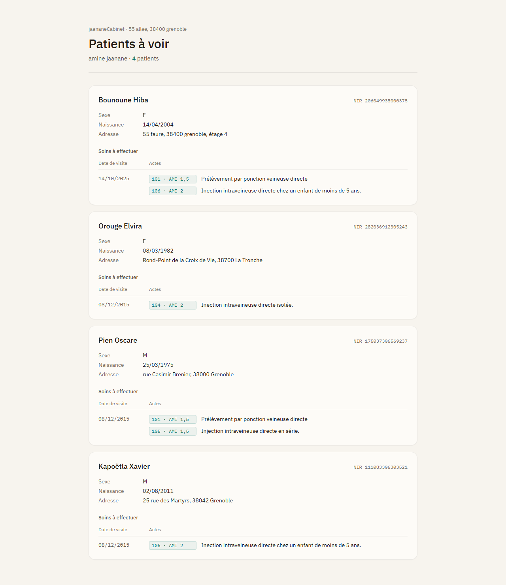
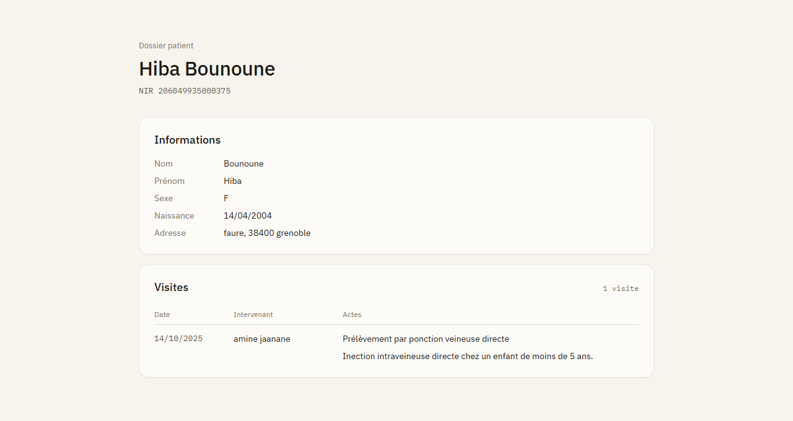
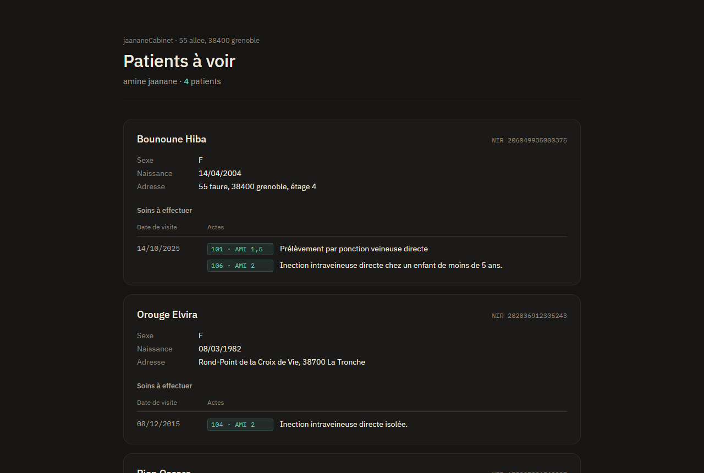
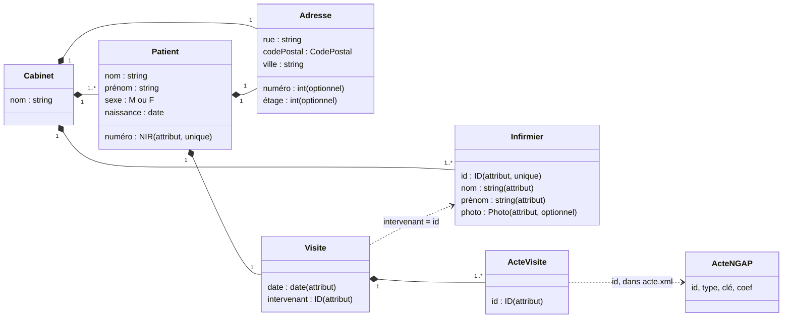
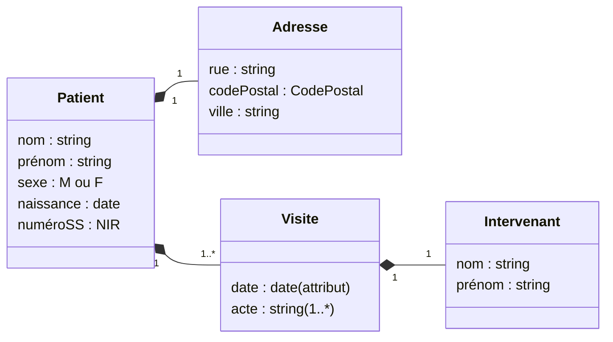
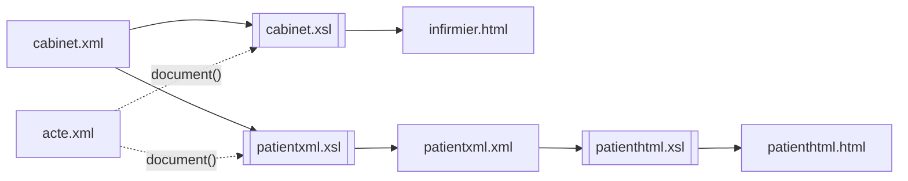

# Cabinet Infirmier

Modélisation XML d'un cabinet de soins infirmiers à domicile : les données (cabinet, infirmiers, patients, visites, nomenclature des actes) sont décrites en XML, contraintes par des schémas XSD, puis transformées en XSLT en deux pages HTML :

- la **tournée de l'infirmier** : les patients qu'il doit voir et les soins à effectuer, avec le code NGAP de chaque acte ;
- le **dossier d'un patient** : ses informations et l'historique de ses visites.

Projet réalisé en L3 MIAGE à l'Université Grenoble Alpes.



---

## Sommaire

1. [Aperçu](#aperçu)
2. [Structure du dépôt](#structure-du-dépôt)
3. [Démarrage rapide](#démarrage-rapide)
4. [Modèle de données](#modèle-de-données)
5. [Schémas XSD et contraintes](#schémas-xsd-et-contraintes)
6. [Transformations XSLT](#transformations-xslt)
7. [Interface](#interface)
8. [Facturation (JavaScript)](#facturation-javascript)
9. [Projet .NET](#projet-net)
10. [Limites connues et pistes](#limites-connues-et-pistes)
11. [Auteur](#auteur)

---

## Aperçu

| Tournée de l'infirmier | Dossier patient |
| --- | --- |
|  |  |

Les pages suivent le thème du système (clair ou sombre) :



---

## Structure du dépôt

```
CabinetInfirmier/
├── data/
│   ├── xml/
│   │   ├── cabinet.xml        Données du cabinet : infirmiers, patients, visites
│   │   ├── acte.xml           Nomenclature NGAP : types et actes avec lettre-clé et coefficient
│   │   ├── patient.xml        Exemple de dossier patient saisi à la main
│   │   └── patientxml.xml     Dossier patient généré par patientxml.xsl
│   ├── xsd/
│   │   ├── cabinet.xsd        Schéma de cabinet.xml
│   │   ├── actes.xsd          Schéma de acte.xml
│   │   └── patient.xsd        Schéma des dossiers patient
│   ├── xslt/
│   │   ├── cabinet.xsl        cabinet.xml → page HTML de la tournée
│   │   ├── patientxml.xsl     cabinet.xml → dossier XML d'un patient
│   │   └── patienthtml.xsl    dossier XML d'un patient → page HTML
│   ├── html/
│   │   ├── infirmier.html     Résultat de cabinet.xsl
│   │   └── patienthtml.html   Résultat de patienthtml.xsl
│   ├── css/
│   │   ├── infirmier.css      Styles de la tournée
│   │   └── patient.css        Styles du dossier patient
│   ├── js/
│   │   └── facture.js         Génération d'une facture (squelette à compléter)
│   └── uml/
│       ├── cabinet.puml       Diagramme de classes du cabinet (PlantUML)
│       └── patient.puml       Diagramme de classes du dossier patient (PlantUML)
├── docs/captures/             Captures d'écran utilisées dans ce README
├── CabinetInfirmier.csproj    Projet .NET 8 (conteneur pour l'IDE)
├── CabinetInfirmier.sln
├── Program.cs
└── global.json
```

---

## Démarrage rapide

### Voir les pages

Les pages déjà générées s'ouvrent directement dans un navigateur :

- [data/html/infirmier.html](data/html/infirmier.html)
- [data/html/patienthtml.html](data/html/patienthtml.html)

Les feuilles de style sont référencées en chemin relatif (`../css/…`), il n'y a donc pas besoin de serveur. Les polices IBM Plex sont chargées depuis Google Fonts ; hors ligne, la police système prend le relais.

### Régénérer les pages

Les commandes se lancent depuis la racine du dépôt. Chaque transformation charge `acte.xml` via `document('../xml/acte.xml', /)`, chemin résolu par rapport au fichier XML source : il faut donc laisser les fichiers dans `data/xml/`.

**Avec xsltproc** (libxslt, disponible sous Linux, macOS, WSL) :

```bash
# Tournée de l'infirmier 001
xsltproc --stringparam destinedId 001 \
  -o data/html/infirmier.html data/xslt/cabinet.xsl data/xml/cabinet.xml

# Dossier XML de la patiente dont le prénom est Hiba, puis sa page HTML
xsltproc --stringparam destinedName Hiba \
  -o data/xml/patientxml.xml data/xslt/patientxml.xsl data/xml/cabinet.xml
xsltproc -o data/html/patienthtml.html data/xslt/patienthtml.xsl data/xml/patientxml.xml
```

**Avec Saxon** (Java) :

```bash
java -jar saxon-he.jar -s:data/xml/cabinet.xml -xsl:data/xslt/cabinet.xsl \
  -o:data/html/infirmier.html destinedId=001
```

**Avec PowerShell** (moteur XSLT de .NET, rien à installer sous Windows) :

```powershell
function Invoke-Xslt($xsl, $xml, $out) {
    $t = New-Object System.Xml.Xsl.XslCompiledTransform
    $resolver = New-Object System.Xml.XmlUrlResolver
    # true = autoriser la fonction document(), nécessaire pour lire acte.xml
    $t.Load((Resolve-Path $xsl).Path, (New-Object System.Xml.Xsl.XsltSettings($true, $false)), $resolver)
    $reader = [System.Xml.XmlReader]::Create((Resolve-Path $xml).Path)
    $writer = [System.Xml.XmlWriter]::Create("$PWD\$out", $t.OutputSettings)
    $t.Transform($reader, $null, $writer, $resolver)
    $writer.Close(); $reader.Close()
}

Invoke-Xslt data\xslt\cabinet.xsl     data\xml\cabinet.xml     data\html\infirmier.html
Invoke-Xslt data\xslt\patienthtml.xsl data\xml\patientxml.xml  data\html\patienthtml.html
```

Les IDE JetBrains (Rider, IntelliJ) et Oxygen XML permettent aussi de lancer une transformation depuis le fichier XSL.

### Valider les fichiers XML

```bash
xmllint --noout --schema data/xsd/cabinet.xsd data/xml/cabinet.xml
xmllint --noout --schema data/xsd/actes.xsd   data/xml/acte.xml
xmllint --noout --schema data/xsd/patient.xsd data/xml/patient.xml
xmllint --noout --schema data/xsd/patient.xsd data/xml/patientxml.xml
```

Les quatre fichiers sont valides par rapport à leur schéma (vérifié avec le validateur de .NET).

---

## Modèle de données

Trois espaces de noms séparent les trois vocabulaires :

| Préfixe | Espace de noms | Fichiers |
| --- | --- | --- |
| `med` | `http://www.univ-grenoble-alpes.fr/l3miage/medical` | `cabinet.xml`, `cabinet.xsd` |
| `act` | `http://www.univ-grenoble-alpes.fr/l3miage/actes` | `acte.xml`, `actes.xsd` |
| `pat` | `http://www.univ-grenoble-alpes.fr/l3miage/patient` | `patient.xml`, `patientxml.xml`, `patient.xsd` |

### Le cabinet (`cabinet.xml`)

Le cabinet a un nom, une adresse, une liste d'infirmiers et une liste de patients. Chaque patient reçoit une visite, qui référence l'infirmier intervenant par son identifiant et les actes réalisés par leur identifiant dans la nomenclature.



Extrait :

```xml
<patient numéro="206049935000375">
    <nom>Bounoune</nom>
    <prénom>Hiba</prénom>
    <sexe>F</sexe>
    <naissance>2004-04-14</naissance>
    <adresse>
        <numéro>55</numéro>
        <rue>faure</rue>
        <codePostal>38400</codePostal>
        <ville>grenoble</ville>
        <étage>4</étage>
    </adresse>
    <visite date="2025-10-14" intervenant="001">
        <acte id="101"/>
        <acte id="106"/>
    </visite>
</patient>
```

### La nomenclature des actes (`acte.xml`)

Elle reprend une partie de la NGAP (Nomenclature générale des actes professionnels). Chaque acte a un identifiant à trois chiffres, un type, une lettre-clé et un coefficient.

| Type | Libellé | Identifiants |
| --- | --- | --- |
| `pi` | Prélèvements et injections | 101 à 113 |
| `pc` | Pansements courants | 200 à 204 |
| `pl` | Pansements lourds et complexes | 300 à 303 |
| `sd` | Soins infirmiers à domicile pour un patient dépendant | 401 à 403 |

```xml
<acte id="101" type="pi" clé="AMI" coef="1.5"> Prélèvement par ponction veineuse directe </acte>
```

Le tarif d'un acte vaut **valeur de la lettre-clé × coefficient**, avec les valeurs utilisées dans `facture.js` :

| Lettre-clé | Signification | Valeur |
| --- | --- | --- |
| `AMI` | Acte médico-infirmier | 3,15 € |
| `AIS` | Acte infirmier de soins | 2,65 € |
| `DI` | Démarche de soins infirmiers | 10,00 € |

Exemple : l'acte 101 (`AMI 1,5`) vaut 1,5 × 3,15 = 4,725 €.

### Le dossier patient (`patient.xml`, `patientxml.xml`)

C'est une vue d'un seul patient, autonome : le NIR devient un élément `numéroSS`, l'intervenant est décrit par son nom et son prénom, et chaque acte par son intitulé en clair. `patient.xml` est un exemple écrit à la main ; `patientxml.xml` est produit à partir de `cabinet.xml` par `patientxml.xsl`.



Les diagrammes d'origine, au format PlantUML, sont dans [data/uml/](data/uml/). Pour les afficher, utiliser le plugin PlantUML de votre IDE ou [plantuml.com](https://www.plantuml.com/plantuml).

---

## Schémas XSD et contraintes

Tous les schémas utilisent `elementFormDefault="qualified"` : chaque élément des documents doit appartenir à l'espace de noms cible.

### Types simples

| Type | Défini dans | Contrainte | Exemple valide |
| --- | --- | --- | --- |
| `NIR` | `cabinet.xsd`, `patient.xsd` | 15 caractères, motif ci-dessous | `206049935000375` |
| `CodePostal` | `cabinet.xsd`, `patient.xsd` | `(0[1-9]\|[1-9][0-9]\|2A\|2B\|9[78])\d{3}` | `38400`, `2A004` |
| `ID` | `cabinet.xsd` | entier écrit sur 3 chiffres `[0-9]{3}` | `001`, `106` |
| `Photo` | `cabinet.xsd` | nom de fichier `.jpg`, `.jpeg` ou `.png` | `amine.png` |
| `Sexe` | `cabinet.xsd`, `patient.xsd` | énumération `M`, `F` | `F` |
| `IdAc` | `actes.xsd` | entier sur 3 chiffres | `101` |
| `IdTy` | `actes.xsd` | deux lettres minuscules `[a-z]{2}` | `pi` |

Le code postal couvre les départements 01 à 99, la Corse (`2A`, `2B`) et l'outre-mer (`97`, `98`).

### Le NIR

Le numéro de sécurité sociale est un `string` et non un `int` : 15 chiffres dépassent la capacité d'un entier 32 bits, et le zéro de tête d'un département doit être conservé.

```
[12] \d{2} (0[1-9]|1[0-2]) (0[1-9]|[1-8]\d|9[0-5]|99) \d{3} \d{3} \d{2}
 │    │     │               │                          │     │     └─ clé de contrôle
 │    │     │               │                          │     └─ rang d'inscription à l'état civil
 │    │     │               │                          └─ code Insee de la commune ou du pays
 │    │     │               └─ département de naissance (99 = né à l'étranger)
 │    │     └─ mois de naissance
 │    └─ deux derniers chiffres de l'année de naissance
 └─ sexe : 1 homme, 2 femme
```

Le motif vérifie la forme ; la clé de contrôle (97 moins le reste modulo 97 des 13 premiers chiffres) n'est pas calculée, XSD 1.0 ne permet pas ce calcul.

### Contraintes d'identité (`cabinet.xsd`)

```xml
<unique name="idInfirmier">           <!-- deux infirmiers ne partagent pas un id -->
    <selector xpath=".//med:infirmier"/>
    <field xpath="@id"/>
</unique>
<unique name="NIR">                   <!-- deux patients ne partagent pas un NIR -->
    <selector xpath=".//med:patient"/>
    <field xpath="@numéro"/>
</unique>
<keyref name="refIntervenant" refer="med:idInfirmier">
    <!-- l'intervenant d'une visite doit être un infirmier du cabinet -->
    <selector xpath=".//med:patients/med:patient/med:visite"/>
    <field xpath="@intervenant"/>
</keyref>
```

Dans `actes.xsd`, une contrainte `unique` garantit que chaque type d'acte a un `id` distinct.

---

## Transformations XSLT

Toutes les feuilles sont en XSLT 1.0, ce qui les rend utilisables avec n'importe quel processeur (navigateur, xsltproc, Saxon, .NET).



### `cabinet.xsl` : la tournée de l'infirmier

| Paramètre | Valeur par défaut | Rôle |
| --- | --- | --- |
| `destinedId` | `001` | identifiant de l'infirmier dont on affiche la tournée |

Fonctionnement :

1. La nomenclature est chargée une fois dans une variable globale :
   `<xsl:variable name="actes" select="document('../xml/acte.xml', /)/act:ngap"/>`
2. Les patients retenus sont ceux qui ont au moins une visite de cet infirmier :
   `med:patient[med:visite/@intervenant = $destinedId]`. Leur nombre s'affiche en en-tête.
3. Pour chaque patient : nom, NIR, sexe, date de naissance, adresse sur une ligne (numéro et étage seulement s'ils existent), puis le tableau des visites de cet infirmier.
4. Chaque `<acte id="…"/>` est cherché dans la nomenclature (`$actes/act:actes/act:acte[@id = $idActeVisite]`) pour afficher son code (`101 · AMI 1,5`) et son intitulé.
5. Un modèle nommé `date` convertit `AAAA-MM-JJ` en `JJ/MM/AAAA` et produit un élément `<time datetime="…">`.

### `patientxml.xsl` : extraire le dossier d'un patient

| Paramètre | Valeur par défaut | Rôle |
| --- | --- | --- |
| `destinedName` | `Hiba` | prénom du patient à extraire |

La feuille sort du XML dans l'espace de noms `pat` (`exclude-result-prefixes="med act"` évite de recopier les autres espaces de noms). Elle remplace l'identifiant de l'intervenant par son nom et son prénom (`//med:infirmier[@id = $idIntervenant]`) et chaque identifiant d'acte par son intitulé dans `acte.xml`. Le résultat est valide par rapport à `patient.xsd`.

### `patienthtml.xsl` : afficher le dossier

Transforme un dossier `pat:patient` en page HTML : en-tête avec le nom et le NIR, bloc d'informations, puis tableau des visites (date, intervenant, actes) avec leur nombre.

---

## Interface

Les deux pages partagent une même direction visuelle : une feuille de tournée sur papier, sobre et lisible pendant une journée de soins.

- **Couleurs** : fond papier `#f7f4ee`, cartes `#fdfbf7`, filets à 8 % d'opacité, trois niveaux de texte. Un seul accent, vert sarcelle `#0f766e`, réservé au nombre de patients et aux codes NGAP.
- **Mode sombre** : automatique via `prefers-color-scheme`, avec les mêmes rôles de couleur (accent `#5fc4b6`).
- **Typographie** : IBM Plex Sans pour le texte, IBM Plex Mono pour les données à lire d'un coup d'œil (NIR, dates, codes d'actes), chiffres tabulaires.
- **Espacements** : grille de 4 px (8, 12, 16, 24, 32…).
- **Codes NGAP** : chaque acte est précédé de son code (`106 · AMI 2`), pour retrouver la cotation sans ouvrir la nomenclature.
- **Petits écrans** : sous 600 px, les tableaux passent en lecture verticale (date, puis actes).
- **Impression** : fond blanc et cartes non coupées entre deux pages, pour imprimer la tournée.

Les variables de couleur sont déclarées en tête de [data/css/infirmier.css](data/css/infirmier.css) et [data/css/patient.css](data/css/patient.css).

---

## Facturation (JavaScript)

[data/js/facture.js](data/js/facture.js) prépare la génération d'une facture HTML pour un patient :

- `afficherFacture(prenom, nom, actes)` cherche le patient dans le XML, affiche son adresse et son NIR, puis un tableau des actes (type, clé, intitulé, coefficient, tarif) et le total ;
- `acteTable(acteId)` doit retrouver un acte dans la nomenclature et calculer son tarif ;
- `adresseToText(adresse)` doit mettre en forme l'adresse ;
- `loadXMLDoc(docName)` charge un document XML par `XMLHttpRequest` synchrone.

**État : squelette à compléter.** Les parties marquées `A compléter` ne sont pas écrites, le tableau affiche `???`, et le fichier n'est relié à aucune page. Voir [Limites connues](#limites-connues-et-pistes).

---

## Projet .NET

`CabinetInfirmier.csproj` cible .NET 8 (`global.json` fixe le SDK 8.0). `Program.cs` affiche seulement `Hello, World!` : le projet sert de conteneur pour ouvrir le dossier dans Rider ou Visual Studio, la logique est dans `data/`.

```bash
dotnet run
```

---

## Limites connues et pistes

**Données et schémas**

- `cabinet.xsd` n'autorise qu'**une visite par patient** (`visite` sans `maxOccurs`). Pour un suivi réel, passer à `maxOccurs="unbounded"`.
- `actes.xsd` ne contraint pas encore l'unicité des identifiants d'actes, ni le lien entre l'attribut `type` d'un acte et les `<type id="…">` déclarés (une `key` et une `keyref` suffiraient). Rien ne vérifie non plus que les `<acte id="…"/>` de `cabinet.xml` existent dans `acte.xml`, puisqu'ils sont dans deux documents différents.
- `patientxml.xsl` sélectionne le patient par son **prénom**, qui n'est pas unique ; le NIR serait un meilleur paramètre. La feuille regroupe aussi tous les actes dans un seul élément `<visite>`, ce qui convient tant qu'un patient n'a qu'une visite.
- Quelques coquilles dans les intitulés de `acte.xml` : « Inection » (actes 104 et 106), « sytologiques », « compirs », « démache », « infirimiers », « rigoueuse », « permanante ». Elles apparaissent telles quelles dans les pages générées.
- Dans `cabinet.xml`, les commentaires de deux visites ne correspondent pas aux actes référencés (105 est une injection « en série », 106 une injection « chez un enfant de moins de 5 ans »).

**Facturation**

- `facture.js` charge `data/cabinetInfirmier.xml` et `data/actes.xml`, alors que les fichiers s'appellent `data/xml/cabinet.xml` et `data/xml/acte.xml`.
- La recherche par `getElementsByTagName("patient")` ignore les espaces de noms ; `getElementsByTagNameNS` serait plus sûr.
- Les fonctions `acteTable` et `adresseToText` restent à écrire, et la feuille `css/mystyle.css` référencée n'existe pas.

**Divers**

- `data/css/background.png.css` est vide et `data/css/photoprj.png` n'est utilisé par aucune page.
- Les pages chargent leurs polices depuis Google Fonts ; pour un usage hors ligne, les polices peuvent être copiées dans le dépôt.

---

## Auteur

**Mohamed-Amine Jaanane**, L3 MIAGE, Université Grenoble Alpes.
